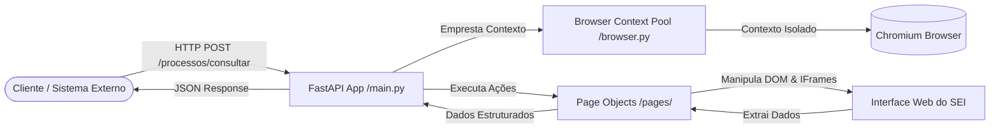
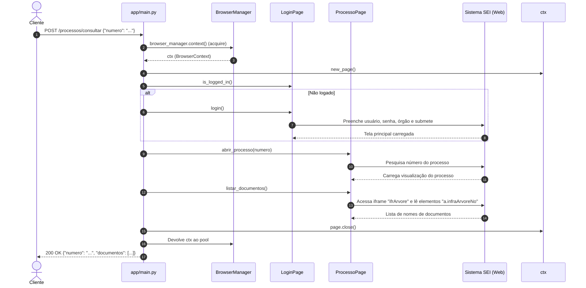

# 🏛️ Documentação de Arquitetura e Estrutura — SEI Automation API

Esta documentação detalha a arquitetura, o fluxo de dados, os padrões de projeto e o funcionamento de cada módulo da **SEI Automation API**.

---

## 1. Visão Geral do Sistema

A **SEI Automation API** é uma camada de integração REST construída com **FastAPI** e **Playwright Async** que transforma ações manuais na interface Web do Sistema Eletrônico de Informações (**SEI**) em chamadas de API JSON automatizadas e programáticas.



---

## 2. Estrutura de Pastas e Arquivos

```text
sei-api/
│
├── .env                  # Credenciais e configurações ativas do ambiente local
├── .env.example          # Modelo de variáveis de ambiente
├── requirements.txt      # Dependências Python (FastAPI, Playwright, Pydantic)
├── teste_play.py         # Script de teste/gravação direta (Playwright codegen)
├── README.md             # Guia rápido de instalação e comandos
├── ARQUITETURA.md         # Esta documentação completa de arquitetura
│
└── app/
    ├── __init__.py
    ├── config.py         # Leitura tipada de configurações via Pydantic Settings
    ├── schemas.py        # DTOs / Modelos de entrada e saída (Pydantic)
    ├── browser.py        # Gerenciamento do ciclo de vida e pool do Playwright
    ├── main.py           # Aplicação FastAPI, rotas e ciclo de vida (Lifespan)
    └── pages/            # Padrão Page Object Model (POM)
        ├── __init__.py
        ├── base_page.py     # Classe base com helpers de DOM e iframes
        ├── login_page.py    # Automação de autenticação do SEI
        └── processo_page.py # Automação de busca e leitura de processos
```

---

## 3. Detalhamento dos Componentes

### 3.1. `app/config.py` — Configurações da Aplicação
- **Objetivo**: Centralizar e tipar as configurações do sistema a partir de variáveis de ambiente ou arquivo `.env`.
- **Classe `Settings`**:
  - `sei_base_url`: URL de entrada do SEI.
  - `sei_usuario` e `sei_senha`: Credenciais de autenticação no sistema.
  - `sei_orgao`: Identificador ou sigla do órgão a ser selecionado no login.
  - `headless`: Controla se o navegador roda em segundo plano (`True`) ou visível (`False` para debug).
  - `nav_timeout_ms`: Tempo limite de espera para ações e carregamento de páginas (padrão: 30s).
  - `pool_size`: Número de sessões/contextos de navegação simultâneos prontos no pool.
- Utiliza `@lru_cache` para garantir que o arquivo de configuração só seja lido uma vez na memória.

---

### 3.2. `app/browser.py` — Gerenciador do Playwright e Pool de Contextos
Este é o coração de desempenho da sua aplicação.

#### Por que um Pool de Contextos?
Subir um processo do Chromium do zero gasta muita CPU e leva de 1.5 a 3 segundos por chamada. Se a API fizesse isso a cada requisição HTTP, a performance seria inviável.
- **`Browser` (1 instância)**: Um único processo Chromium é iniciado no boot da API.
- **`BrowserContext` (Pool de N instâncias)**: São como janelas anônimas isoladas (cada uma tem seus próprios cookies, cache e páginas). O overhead de criar e reutilizar contextos é de poucos milissegundos.
- **Fila Assíncrona (`asyncio.Queue`)**: Atua como semáforo de concorrência:
  1. A rota chama `async with browser_manager.context() as ctx:`.
  2. Pega um contexto livre da fila. Se todos estiverem ocupados, a requisição aguarda até um ficar livre.
  3. Ao terminar a requisição (bloco `finally`), o contexto é devolvido intacto à fila.

---

### 3.3. `app/schemas.py` — Contratos de Dados (DTOs)
Utiliza **Pydantic v2** para validação automática de entrada e serialização de saída:
- `ProcessoRequest`: Define o formato de entrada da requisição (`numero: str`).
- `ProcessoResponse`: Estrutura o retorno da API (`numero: str`, `documentos: list[str]`).
- `HealthResponse`: Retorno da checagem de saúde da API (`status: str`).

---

### 3.4. `app/pages/` — Padrão Page Object Model (POM)
O **Page Object Model** separa a *lógica de negócio da API* dos *seletores de tela (HTML/DOM)* do SEI. Se a tela do SEI mudar de layout amanhã, você só altera o Page Object correspondente, sem mexer no endpoint da API.

#### `base_page.py`
Fornece métodos genéricos com auto-wait nativo do Playwright:
- `goto(url)`: Navega até uma URL aguardando `domcontentloaded`.
- `click(selector)`: Espera o elemento estar visível, estável e clica.
- `fill(selector, value)`: Preenche inputs.
- `text(selector)`: Lê o conteúdo de texto limpo.
- `frame_by_name(name)`: **Essencial para o SEI**. Localiza frames e iframes específicos (`ifrArvore`, `ifrConteudoVisualizacao`, etc.).

#### `login_page.py`
Encapsula o fluxo de login no SEI:
- `login()`: Acessa a URL, preenche usuário, senha, seleciona órgão e clica no botão de acesso. Aguarda a confirmação de entrada na home.
- `is_logged_in()`: Verifica se a sessão atual já está logada.

#### `processo_page.py`
Encapsula a navegação no processo:
- `abrir_processo(numero)`: Realiza a pesquisa pelo número do processo.
- `listar_documentos()`: Acessa o iframe da árvore (`ifrArvore`) e extrai os títulos de todos os nós/documentos anexados.

---

### 3.5. `app/main.py` — Entrada da Aplicação e Endpoints
- **Windows Event Loop**: Configura explicitamente `asyncio.WindowsProactorEventLoopPolicy()`, obrigatório no Windows para que o Playwright consiga gerenciar subprocessos sem quebrar o loop do Uvicorn.
- **Lifespan Manager**:
  - Na subida da API (`startup`): inicializa o Chromium e o pool de contextos.
  - No encerramento da API (`shutdown`): fecha contextos, fecha o navegador e desliga o Playwright com segurança.
- **Rotas**:
  - `GET /health`: Endpoint simples para monitoramento de disponibilidade.
  - `POST /processos/consultar`:
    1. Reserva contexto do pool.
    2. Abre uma nova página (`page = await ctx.new_page()`).
    3. Verifica se precisa de login e loga.
    4. Abre o processo e coleta os documentos.
    5. Fecha a página temporária (`await page.close()`).
    6. Trata exceções específicas como `TimeoutError` (retornando HTTP 504) e erros genéricos (retornando HTTP 500).

---

## 4. Diagrama de Sequência de uma Requisição



---

## 5. Como o SEI Estrutura sua Interface (O Desafio dos IFrames)

O SEI foi projetado com uma arquitetura clássica baseada em múltiplos iframes divididos na tela:
1. **Página Principal (Top Window)**: Contém o cabeçalho, barra de pesquisa rápida e navegação superior.
2. **`ifrArvore` (Lado Esquerdo)**: O iframe que renderiza a árvore de documentos e pastas do processo.
3. **`ifrConteudoVisualizacao` (Lado Direito)**: O container que recebe a visualização do documento selecionado.
4. **`ifrVisualizacao` (Dentro do Conteúdo)**: Muitas vezes um iframe aninhado dentro do anterior onde o PDF ou HTML gerado do documento é exibido.

> **Importante**: No Playwright, para interagir com elementos dentro de um iframe, use:
> ```python
> frame = self.frame_by_name("ifrArvore")
> elemento = frame.locator("seletor_aqui")
> ```
> Ou encadeamento de frames:
> ```python
> frame_interno = self.page.frame_locator("iframe[name='ifrConteudoVisualizacao']").frame_locator("iframe[name='ifrVisualizacao']")
> ```

---

## 6. Diagnóstico e Pontos de Atenção na Implementação Atual

Analisando o código atual em comparação com o script de teste real (`teste_play.py`), identificamos os seguintes pontos que merecem atenção:

1. **Diferença de Seletores entre `teste_play.py` e os Page Objects**:
   - No `teste_play.py` (específico do SEI Minas Gerais):
     - Campo de pesquisa: `get_by_role("textbox", name="Pesquisar...")`
     - Campo de órgão: seleciona `"21"` via ID `#selOrgao`
     - URL de login direta: `https://www.sei.mg.gov.br/sip/login.php?...`
   - No `login_page.py` e `processo_page.py`:
     - Estão com seletores genéricos (`#txtPesquisaRapida`, `#txtInfraPesquisar`, etc.).
     - *Recomendação*: Alinhar os seletores dos Page Objects com o que foi gravado e validado no `teste_play.py`.

2. **Reaproveitamento de Sessão (Storage State)**:
   - Atualmente, cada contexto novo precisa fazer o login do zero.
   - *Oportunidade de Otimização*: Fazer login uma única vez no `startup`, salvar o estado dos cookies (`await context.storage_state(path="auth.json")`) e instanciar os contextos do pool já com a sessão ativa. Isso reduz o tempo de cada requisição em até 70%.

3. **Limpeza entre Requisições**:
   - Como os contextos são devolvidos ao pool, qualquer página aberta deve ser fechada para evitar vazamento de memória. O código atual já faz isso corretamente com o bloco `finally: await page.close()`.

---

## 7. Como Adicionar uma Nova Rota na API (Guia Passo a Passo)

Para criar uma nova funcionalidade (por exemplo: baixar um documento específico ou incluir um documento):

1. **Gravar a interação com Playwright Codegen**:
   ```bash
   playwright codegen https://www.sei.mg.gov.br/sip/login.php?...
   ```
2. **Criar ou estender o Page Object em `app/pages/`**:
   - Exemplo: adicionar o método `async def baixar_documento(self, nome_doc: str)` em `app/pages/processo_page.py`.
3. **Definir o Schema de Entrada e Saída em `app/schemas.py`**:
   - Exemplo: `DownloadRequest` e `DownloadResponse`.
4. **Criar a rota em `app/main.py`**:
   ```python
   @app.post("/processos/documento/download")
   async def download_doc(req: DownloadRequest):
       async with browser_manager.context() as ctx:
           page = await ctx.new_page()
           try:
               # executa ações via Page Objects
               ...
           finally:
               await page.close()
   ```
