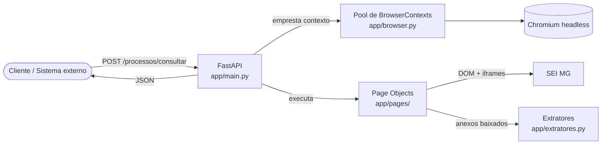
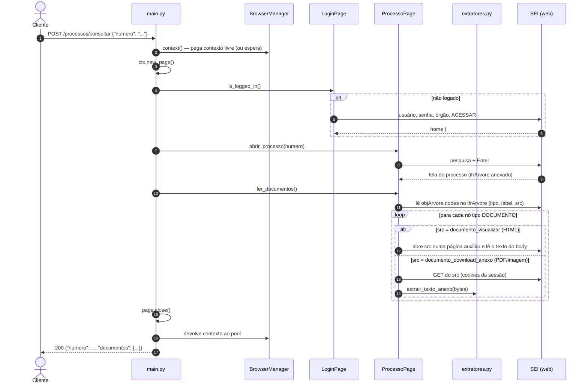

# Documentação de Arquitetura — SEI Automation API

Documento de referência do projeto: o que ele faz, como cada peça funciona, como rodar, como depurar, o que está pendente e o que considerar na migração para **Docker / Docker Compose**.

> Estado descrito: outubro/2026 — Python 3.12, FastAPI 0.143, Playwright 1.63 (Chromium 153), Pydantic 2.14, pypdf 6.19. SEI de Minas Gerais (`www.sei.mg.gov.br`, SEI 5.0.4).

---

## Sumário

1. [Visão geral](#1-visão-geral)
2. [Estrutura de pastas](#2-estrutura-de-pastas)
3. [Componentes](#3-componentes)
4. [Fluxo de uma requisição](#4-fluxo-de-uma-requisição)
5. [Como o SEI organiza a tela (iframes)](#5-como-o-sei-organiza-a-tela-iframes)
6. [Leitura de documentos: HTML, PDF e imagem](#6-leitura-de-documentos-html-pdf-e-imagem)
7. [Configuração (variáveis de ambiente)](#7-configuração-variáveis-de-ambiente)
8. [Rodando localmente](#8-rodando-localmente)
9. [Gravando automações com o Playwright Codegen](#9-gravando-automações-com-o-playwright-codegen)
10. [Depuração](#10-depuração)
11. [Problemas conhecidos e soluções aplicadas](#11-problemas-conhecidos-e-soluções-aplicadas)
12. [Limitações e pendências](#12-limitações-e-pendências)
13. [Migração para Docker e Docker Compose](#13-migração-para-docker-e-docker-compose)
14. [Como adicionar uma nova rota](#14-como-adicionar-uma-nova-rota)
15. [Segurança e dados sensíveis](#15-segurança-e-dados-sensíveis)

---

## 1. Visão geral

A **SEI Automation API** é uma API REST (FastAPI) que transforma ações manuais na interface web do **SEI** em chamadas HTTP com resposta JSON. Por baixo, um navegador **Chromium** controlado pelo **Playwright** faz login, pesquisa o processo, percorre a árvore de documentos e extrai o conteúdo de cada um.



**Entrada:** número do processo. **Saída:** `{ "numero": ..., "documentos": { "<nome do documento>": "<conteúdo em texto>" } }`.

---

## 2. Estrutura de pastas

```text
ProjetoApiSei2.0/
├── .env                  # credenciais reais (NUNCA versionar)
├── .env.example          # modelo das variáveis de ambiente
├── .gitignore
├── requirements.txt      # dependências Python
├── README.md             # guia rápido
├── ARQUITETURA.md        # este documento
├── teste_play.py         # gravação síncrona do codegen (referência de seletores)
├── gravacao_async.py     # gravação assíncrona do codegen (referência de seletores)
├── documento_html        # amostra do DOM de um documento HTML do SEI   (dados pessoais!)
├── documento_pdf         # amostra do DOM de um anexo PDF               (dados pessoais!)
├── documento_imagem      # amostra do DOM de um anexo imagem            (dados pessoais!)
├── projeto_espelho/      # projeto de referência (robo_sei, Selenium) que inspirou o ofício de resposta
├── dados/
│   ├── dadosmil.json         # cadastro dos militares por CPF (dados pessoais! fora do git)
│   ├── dadosmil.example.json # formato do cadastro
│   └── etiquetas.json        # marcadores oferecidos na interface
│
└── app/
    ├── __init__.py
    ├── config.py         # Settings (pydantic-settings) lidas do .env
    ├── schemas.py        # modelos de entrada/saída da API (Pydantic)
    ├── browser.py        # BrowserManager: 1 Chromium + pool de contextos
    ├── extratores.py     # bytes de anexo -> texto (PDF via pypdf, imagem via OCR opcional)
    ├── ia.py             # OpenAI: prompt do ofício e conversão da resposta em parágrafos
    ├── militares.py      # leitura do dadosmil.json
    ├── modelos.py        # modelo HTML do ofício e texto do despacho
    ├── fluxo_oficio.py   # fluxo completo do ofício de resposta, com eventos de progresso
    ├── main.py           # app FastAPI, lifespan, rotas, tratamento de erros
    ├── static/           # interface web (index.html, style.css, app.js) servida em "/"
    └── pages/            # Page Object Model
        ├── __init__.py
        ├── base_page.py       # helpers: goto, click, fill, text, iframe, enviar_formulario
        ├── login_page.py      # login no SEI
        ├── processo_page.py   # pesquisa, leitura, inclusão de documento, marcador, atribuição
        ├── documento_page.py  # criação de documento (Gerar Documento + editor)
        ├── marcador_page.py   # Gerenciar Marcadores (etiqueta + anotação = despacho)
        └── atribuicao_page.py # Atribuir Processo
```

---

## 3. Componentes

### 3.1 `app/config.py` — configurações

Classe `Settings` (pydantic-settings) que lê variáveis de ambiente e, se existir, o arquivo `.env` do diretório de trabalho. Variáveis de ambiente reais **têm prioridade** sobre o `.env` — o que é exatamente o comportamento desejado no Docker (ver [seção 13](#13-migração-para-docker-e-docker-compose)).

| Campo | Variável | Padrão | Uso |
|---|---|---|---|
| `sei_base_url` | `SEI_BASE_URL` | `https://www.sei.mg.gov.br` | URL aberta no login (`{sei_base_url}/`) |
| `sei_usuario` | `SEI_USUARIO` | `""` | usuário (CPF) |
| `sei_senha` | `SEI_SENHA` | `""` | senha |
| `sei_orgao` | `SEI_ORGAO` | `""` | **rótulo** da opção no `#selOrgao` (ex.: `CBMMG`) |
| `headless` | `HEADLESS` | `true` | `false` mostra o navegador (só local; no Docker deve ser `true`) |
| `nav_timeout_ms` | `NAV_TIMEOUT_MS` | `30000` | timeout padrão de toda ação do Playwright |
| `pool_size` | `POOL_SIZE` | `2` | quantos contextos (requisições simultâneas) |
| `ler_imagens` | `LER_IMAGENS` | `false` | `false`: anexos do tipo imagem ficam **fora** do JSON; `true`: são lidos via OCR |
| `criar_documento` | `CRIAR_DOCUMENTO` | `false` | `/processos/consultar` também cria um documento com o texto da IA (o fluxo completo é `/oficios/responder`) |
| `tipo_documento_padrao` | `TIPO_DOCUMENTO_PADRAO` | `Ofício` | tipo criado quando a requisição não informa `tipo_documento` |
| `openai_api_key` | `OPENAI_API_KEY` | `""` | chave da OpenAI; vazio = parágrafos **simulados** |
| `openai_model` | `OPENAI_MODEL` | `gpt-4o-mini` | modelo (o mesmo do robo_sei) |
| `openai_max_tokens` | `OPENAI_MAX_TOKENS` | `1500` | tamanho máximo da resposta |
| `openai_temperature` | `OPENAI_TEMPERATURE` | `0.7` | criatividade da redação |
| `openai_timeout_s` | `OPENAI_TIMEOUT_S` | `120` | timeout da chamada, em segundos |
| `openai_proxy` | `OPENAI_PROXY` | `""` | proxy corporativo (ex.: `http://proxy.prodemge.gov.br:8080`) |
| `ia_max_caracteres` | `IA_MAX_CARACTERES` | `100000` | limite do conteúdo do processo enviado à IA; acima dele, prioriza o documento de referência e os mais recentes |
| `dadosmil_path` | `DADOSMIL_PATH` | `dados/dadosmil.json` | cadastro dos militares |
| `etiquetas_path` | `ETIQUETAS_PATH` | `dados/etiquetas.json` | marcadores oferecidos na interface |
| `despacho_assinatura` | `DESPACHO_ASSINATURA` | `Cap Cleyton` | quem assina o texto do despacho |
| `despacho_max_caracteres` | `DESPACHO_MAX_CARACTERES` | `250` | limite do texto do marcador |

`get_settings()` usa `@lru_cache`: o `.env` é lido uma única vez por processo. Mudou o `.env`? Reinicie a API.

### 3.2 `app/schemas.py` — contratos da API

```python
class ProcessoRequest(BaseModel):
    numero: str                    # ex.: "39563202632" ou "1400.01.0008514/2026-81"

class ProcessoResponse(BaseModel):
    numero: str
    documentos: dict[str, str]     # {nome do documento na árvore: conteúdo em texto}

class HealthResponse(BaseModel):
    status: str
```

### 3.3 `app/browser.py` — `BrowserManager` e pool de contextos

Subir um Chromium custa de 1,5 a 3 s e bastante memória; fazer isso por requisição seria inviável. Por isso:

- **1 `Browser`** é iniciado no startup da API (`chromium.launch(headless=...)`).
- **N `BrowserContext`** (N = `POOL_SIZE`) são criados e guardados numa `asyncio.Queue`. Cada contexto é como uma janela anônima isolada (cookies e cache próprios), com `viewport` 1366x768, `accept_downloads=True` e `set_default_timeout(NAV_TIMEOUT_MS)`.
- `browser_manager.context()` é um `@asynccontextmanager`: pega um contexto da fila (se todos estiverem ocupados, **a requisição espera**), entrega para a rota e o devolve no `finally`.

Consequência importante: o pool vive **na memória de um único processo Python**. Ver implicações para Docker/uvicorn workers na [seção 13.3](#133-pontos-de-atenção-específicos-deste-projeto).

### 3.4 `app/pages/` — Page Object Model

Separa "como a tela do SEI é" (seletores, iframes) de "o que a API faz". Se o layout do SEI mudar, altera-se só o Page Object.

**`base_page.py` — `BasePage`**

| Método | O que faz |
|---|---|
| `goto(url)` | navega e espera `domcontentloaded` |
| `click(sel)` / `fill(sel, v)` / `text(sel)` | ações com auto-wait do Playwright |
| `iframe(name)` | retorna um `FrameLocator` para `iframe[name=...]` — **espera o iframe existir** |
| `frame_by_name(name)` | retorna o `Frame` **imediatamente** ou erro (não espera; evitar logo após navegações) |

**`login_page.py` — `LoginPage`**

- `login()`: abre `SEI_BASE_URL`, preenche `#txtUsuario` e `#pwdSenha`, seleciona o órgão em `#selOrgao` pelo **rótulo**, clica em `#sbmAcessar` e espera `#txtPesquisaRapida` (campo de pesquisa da home) ficar visível.
- `is_logged_in()`: verifica se `#txtPesquisaRapida` existe na página atual.

**`processo_page.py` — `ProcessoPage`**

- `abrir_processo(numero)`: digita o número em `#txtPesquisaRapida`, pressiona Enter no campo e espera o iframe `ifrArvore` (15 s). Se não abrir, repete a pesquisa uma vez — logo após o login a home às vezes ainda está inicializando e ignora o Enter.
- `incluir_documento(tipo, conteudo_html)`: cria um documento no processo (ver [seção 6.1](#61-geração-de-documento-com-o-texto-da-ia)).
- `ler_documentos() -> dict[str, str]`: lê os nós da árvore a partir do objeto JavaScript `objArvore.nodes` (sem clicar em nada) e extrai o conteúdo de cada documento (detalhes na [seção 6](#6-leitura-de-documentos-html-pdf-e-imagem)).
- Métodos internos: `_frame_arvore`, `_ler_html`, `_ler_anexo`.

### 3.5 `app/extratores.py` — conversão de anexos em texto

Funções **síncronas** (pesadas em CPU), chamadas via `asyncio.to_thread` para não travar o event loop.

| Função | Entrada | Saída |
|---|---|---|
| `tipo_anexo(bytes, content_type)` | arquivo baixado | `"pdf"`, `"imagem"` ou `None`, pela assinatura dos bytes (`%PDF`, PNG, JPEG, GIF, TIFF, BMP) ou pelo `Content-Type` |
| `extrair_texto_anexo(bytes, content_type)` | arquivo baixado | usa `tipo_anexo` e delega para a função certa |
| `texto_pdf(bytes)` | PDF | texto de todas as páginas (pypdf) ou `"[PDF sem texto extraível (provavelmente escaneado)]"` |
| `texto_imagem(bytes)` | imagem | OCR em português (pytesseract) ou `"[imagem: OCR não instalado ...]"` se faltar a ferramenta |

Tipos não reconhecidos retornam `"[tipo de anexo não suportado: <content-type>]"`.

### 3.6 `app/main.py` — aplicação e rotas

- **Windows:** força `WindowsProactorEventLoopPolicy` (Playwright precisa de subprocessos). Irrelevante no Linux/Docker.
- **Lifespan:** `browser_manager.startup()` na subida e `shutdown()` no encerramento.
- **Rotas:**

| Método | Rota | Descrição |
|---|---|---|
| `GET` | `/` | interface web do ofício de resposta (`app/static/`) |
| `GET` | `/health` | `{"status": "ok"}` — usar como healthcheck |
| `GET` | `/configuracao` | assinatura e limite do despacho, se a IA está configurada (sem segredos) |
| `GET` | `/militares` | cadastro do `dadosmil.json` |
| `GET` | `/etiquetas` | marcadores do `etiquetas.json` |
| `POST` | `/processos/consultar` | corpo `{"numero": "..."}` → documentos e conteúdos |
| `POST` | `/oficios/responder` | fluxo completo do ofício de resposta, com progresso em NDJSON ([seção 6.2](#62-ofício-de-resposta-interface-web-e-fluxo-completo)) |
| `GET` | `/docs` | Swagger UI gerado pelo FastAPI |

- **Erros:** `TimeoutError` do Playwright → **HTTP 504**; qualquer outra exceção → **HTTP 500**, ambos com a mensagem em `detail`. A página é sempre fechada no `finally` e o contexto volta ao pool.

---

## 4. Fluxo de uma requisição



---

## 5. Como o SEI organiza a tela (iframes)

```text
page (procedimento_trabalhar)
├── #txtPesquisaRapida            campo de pesquisa (frame principal)
├── iframe ifrArvore              árvore de documentos (esquerda) — nós: a.infraArvoreNo
│                                  dados de cada nó no objeto JS window.objArvore.nodes
└── iframe ifrConteudoVisualizacao   painel da direita; RECARREGA a cada clique na árvore
                                     (após um clique podem existir DOIS iframes ifrVisualizacao)
    └── iframe ifrVisualizacao       o documento em si
        ├── HTML:  src = controlador.php?acao=documento_visualizar&id_documento=...
        │          o texto está no <body class="infra-doc">
        └── anexo: src = controlador.php?acao=arvore_processar_html
                   só contém o link a.ancoraVisualizacaoArvore ("Clique aqui")
                   → controlador.php?acao=documento_download_anexo&id_anexo=...
                   e um iframe ifrArvoreHtml com o visualizador do arquivo
```

Regras práticas no Playwright:

- Um seletor do frame principal **não enxerga** elementos dentro de iframes; é preciso entrar no frame.
- `page.frame(name=...)` **não espera** — se o iframe ainda não carregou, retorna `None`. Prefira `page.locator('iframe[name="X"]').content_frame` (auto-wait) ou `element_handle()` + `content_frame()`.
- iframes aninhados: `page.locator('iframe[name="ifrConteudoVisualizacao"]').content_frame.locator('iframe[name="ifrVisualizacao"]').content_frame`.

---

## 6. Leitura de documentos: HTML, PDF e imagem

Implementado em `ProcessoPage.ler_documentos()` / `_ler_html()` / `_ler_anexo()`. **Não há cliques na árvore**: o SEI já entrega, no JavaScript do `ifrArvore`, o endereço direto do conteúdo de cada documento.

1. Espera a árvore ser desenhada (`a.infraArvoreNo` presente) e lê `window.objArvore.nodes`. Exemplo real de nó:

   ```text
   tipo  = "DOCUMENTO"                       ("PROCESSO" na raiz)
   label = "Ofício 76 (132918328)"           (vira a chave do JSON)
   icone = "svg/documento_interno.svg"       (documento_pdf.svg, documento_imagem.svg...)
   src   = "controlador.php?acao=documento_visualizar&...&id_documento=..."
   ```

2. Ignora nós que não são `DOCUMENTO` (a raiz do processo) e documentos sem `src` (sem acesso).
3. Resolve o `src` em URL absoluta e classifica:
   - `documento_download_anexo` → **anexo**. Baixado com `page.context.request.get(url)` — o `APIRequestContext` do contexto **compartilha os cookies** da sessão logada. Se for imagem e `LER_IMAGENS=false`, o documento é **ignorado** (não aparece no JSON); senão os bytes vão para `extrair_texto_anexo`.
   - `documento_visualizar` → **HTML**. Aberto numa **página auxiliar** do mesmo contexto (a página do processo não é alterada) e lido com `inner_text()` do `<body>` (texto renderizado, sem CSS/scripts). Usar o navegador aqui também resolve a codificação `iso-8859-1` do SEI.
4. Nomes repetidos na árvore recebem sufixo: `Despacho`, `Despacho (2)`, ...

Validado em out/2026 com dois processos reais: um com 5 HTMLs, 2 PDFs e 1 imagem; outro com 4 PDFs grandes (até ~160 mil caracteres). Cada processo levou cerca de 10–20 s, incluindo o login.

### 6.1 Geração de documento com o texto da IA

Depois de montar o JSON dos documentos, se `CRIAR_DOCUMENTO=true`, a rota:

1. Monta o prompt (`ia.montar_prompt`) e pede os parágrafos à OpenAI (`ia.gerar_paragrafos`). Sem `OPENAI_API_KEY`, os parágrafos são **simulados**.
2. Converte os parágrafos em `<p>` (com escape de caracteres).
3. `ProcessoPage.incluir_documento(tipo, html)`:
   - pega a ação **Incluir Documento** pronta em `objArvore.nodes[raiz].acoes` (`controlador.php?acao=documento_escolher_tipo...`);
   - em uma página auxiliar, `DocumentoPage.gerar()` (`app/pages/documento_page.py`, equivalente ao `gerador_documento` do script Selenium): `#ancExibirSeries` → link `a.ancoraOpcao` com o texto exato do tipo → `#divOptPublico > div > label` (Público) → `#btnSalvar` (o primeiro dos dois);
   - o SEI abre o **editor numa janela nova** (capturada com `context.expect_page()`); o texto é inserido via API do CKEditor (`CKEDITOR.instances[...].setData`) na seção editável de maior altura (o corpo do texto) e salvo com `a.cke_button__save`;
   - recarrega a tela do processo e compara os ids da árvore antes/depois para descobrir o nome do documento criado.
4. A resposta ganha `documento_gerado: {tipo, nome, conteudo}`.

Atenção: o clique em **Salvar do formulário já cria o documento** no SEI. Se o passo do editor falhar, fica um documento vazio no processo.

Validação (out/2026): fluxo completo executado no processo 1400.01.0008514/2026-81, criando o **Ofício 585 (SEI nº 151163165)** em ~30 s. Relido em seguida pela própria API: cabeçalho, número, data e rodapé vêm do modelo do Ofício; o texto da IA ocupou o corpo (seção `txaEditor_1507`, versão 2 salva pelo editor).

### 6.2 Ofício de resposta: interface web e fluxo completo

Abra `http://localhost:8000/`. A interface (HTML/CSS/JS puro em `app/static/`, sem build) reproduz o "Criador de Ofício" do `projeto_espelho/robo_sei-main`, mas lendo **todo o processo** em vez de um único ofício.

**Formulário → `POST /oficios/responder`** (`OficioRespostaRequest`):

| Campo | Uso |
|---|---|
| `processo` | número do processo |
| `referencia` | documento respondido (ex.: `Ofício 76 (132918328)`); vai para a linha "Referência" e orienta a IA |
| `assunto`, `destinatario` | linha "Assunto" e vocativo do ofício; também entram no despacho e no prompt |
| `complementar` | instruções extras para a IA |
| `signatario_cpf` | CPF do `dadosmil.json`: nome, graduação e função no rodapé |
| `atribuir_cpf` | CPF do `dadosmil.json`: tratamento, nome de guerra, encaminhamento e despedida do despacho + militar da atribuição |
| `etiqueta`, `despacho_complemento`, `despacho_documentos`, `despacho_texto` | marcador e despacho. `despacho_documentos` são os documentos citados, com artigo (padrão `["o {oficio}"]`); `despacho_texto` é a mensagem final (vazia = montada automaticamente). Em ambos, `{oficio}` vira o nome do ofício criado |
| `simular` | `true` = lê o processo e gera os textos **sem gravar nada** no SEI (botão "Pré-visualizar") |
| `criar_oficio`, `adicionar_marcador`, `atribuir` | liga/desliga cada gravação |

**Etapas** (`app/fluxo_oficio.py`):

1. Login e abertura do processo; leitura de todos os documentos (JSON `{nome: conteúdo}`, [seção 6](#6-leitura-de-documentos-html-pdf-e-imagem)).
2. **IA** (`app/ia.py`): o mesmo prompt do `ai_converter.py` (ofício-exemplo + "retorne uma lista de parágrafos"), seguido do conteúdo dos documentos (`### <nome>` + texto) e das informações do formulário. A resposta `['p1', 'p2', ...]` é convertida com `ast.literal_eval`/`json` — **nunca com `eval`**, como fazia o original.
3. **Modelo HTML** (`modelos.oficio_html`, porte do `utils.cria_oficio`): Assunto, Referência, vocativo, parágrafos (`Texto_Justificado_Recuo_Primeira_Linha`), "Respeitosamente," e signatário (`Nome_Signatário`, em maiúsculas).
4. **Ofício**: `incluir_documento` ([seção 6.1](#61-geração-de-documento-com-o-texto-da-ia)).
5. **Despacho** (`modelos.despacho`, porte do gerador de despacho do `script.js`), registrado como **anotação de marcador** (como no robo_sei):
   `"<tratamento> <nome de guerra>. <encaminhamento> o <Ofício N (SEI)> e a <outro doc>, que tratam de <assunto>. <complemento>. <despedida> <DESPACHO_ASSINATURA>."`
   Na interface, o botão **✨ Gerar Despacho** abre o gerador do robo_sei: complemento, artigo (o/a) + nome do documento, lista com remover e **✨ Gerar Texto**, que valida o limite de caracteres. A mensagem gerada continua editável.
   `MarcadorPage`: ação `andamento_marcador_gerenciar` da raiz → se o processo já tem marcadores, `#btnAdicionar` → combo ddslick `#selMarcador .dd-select` → `a.dd-option` com o texto exato → `#txaTexto` → `#sbmSalvar`.
   O limite de 250 caracteres é conferido **antes** de gravar qualquer coisa.
6. **Atribuição** (`AtribuicaoPage`): ação `procedimento_atribuicao_cadastrar` → opção de `#selAtribuicao` cujo texto começa pelo CPF com 11 dígitos (`01256468606 - Nome`; o `dadosmil.json` às vezes perde o zero à esquerda, por isso `militares.normalizar_cpf`) ou, em último caso, termina com o nome → `#sbmSalvar`.

`BasePage.enviar_formulario()` clica no salvar e transforma `alert()` do SEI ou `#divInfraExcecao` em erro.

**Progresso em tempo real:** a rota responde `application/x-ndjson`, uma linha por evento:

```json
{"tipo": "info", "etapa": "leitura", "mensagem": "Lendo documento 3/9: ...", "progresso": 20}
{"tipo": "resultado", "dados": {"oficio": "Ofício 590 (151...)", "paragrafos": [...], "oficio_html": "...", "despacho": "...", "atribuido_a": "...", "documentos": [...]}}
```

O fluxo roda numa `asyncio.Task` que publica numa `asyncio.Queue`; a resposta consome a fila. Se o navegador do usuário fechar a conexão, a tarefa é cancelada.

**`dadosmil.json`** — `{"<cpf>": [nome, nome de guerra, tratamento, despedida, encaminhamento, graduação, função]}`. Lido a cada requisição (editar não exige reiniciar). Contém CPFs: fica fora do git; use `dados/dadosmil.example.json` como modelo.

Validação (out/2026), processo 1400.01.0008514/2026-81, com IA simulada:

- pré-visualização: 8 documentos lidos, ofício e despacho montados, nada gravado (~20 s);
- fluxo completo (~40 s): **Ofício 587 (151163387)** criado; marcador "Aguardando Despacho do Major" com o texto do despacho conferido em "Gerenciar Marcadores"; processo "Atribuído para Fabricio Rocha Xavier" conferido na tela Controle de Processos.

Ajustes que saíram desse teste:

- **Login com sessão ativa:** o contexto do pool guarda os cookies; na requisição seguinte o SEI abre direto na home e não há `#txtUsuario`. `LoginPage.login()` agora espera o campo de usuário **ou** o de pesquisa e dispensa o login se a sessão vale.
- **Formulário "Gerar Documento" que não abre:** às vezes o clique no tipo (`a.ancoraOpcao`) acontece antes de a lista estar pronta e não navega. `DocumentoPage` espera `#lblPublico` e, se não aparecer em 10 s, clica no tipo de novo.

**OCR (imagens e futuramente PDFs escaneados)** — desligado por padrão (`LER_IMAGENS=false`). Para ligar, instale as ferramentas e defina `LER_IMAGENS=true`:

```bash
sudo apt install tesseract-ocr tesseract-ocr-por   # binário + idioma português
pip install pytesseract pillow                     # bindings Python
```

---

## 7. Configuração (variáveis de ambiente)

`.env.example`:

```dotenv
SEI_BASE_URL=https://www.sei.mg.gov.br
SEI_USUARIO=seu_cpf
SEI_SENHA=sua_senha
SEI_ORGAO=CBMMG
HEADLESS=true
NAV_TIMEOUT_MS=30000
POOL_SIZE=2
LER_IMAGENS=false
CRIAR_DOCUMENTO=false
TIPO_DOCUMENTO_PADRAO=Ofício
OPENAI_API_KEY=
OPENAI_MODEL=gpt-4o-mini
OPENAI_PROXY=
DADOSMIL_PATH=dados/dadosmil.json
DESPACHO_ASSINATURA=Cap Cleyton
```

(lista completa no `.env.example` e na [seção 3.1](#31-appconfigpy--configurações))

Nomes de variável não diferenciam maiúsculas/minúsculas. Booleanos aceitam `true/false/1/0`.

---

## 8. Rodando localmente

```bash
python3 -m venv venv
source venv/bin/activate
pip install -r requirements.txt
playwright install chromium
cp .env.example .env            # preencher credenciais
uvicorn app.main:app --reload   # http://127.0.0.1:8000/docs
```

Teste pela linha de comando:

```bash
curl -s -X POST http://127.0.0.1:8000/processos/consultar \
     -H "Content-Type: application/json" \
     -d '{"numero": "39563202632"}'
```

### 8.1 Problema conhecido: `playwright install chromium` falha por timeout (Pop!_OS)

Sintoma: `Request to https://cdn.playwright.dev/... timed out after 300000ms`, mas cada tentativa falha em poucos segundos. O downloader interno do Playwright 1.63 aborta a conexão, embora a rede funcione. Solução: baixar manualmente com `curl` para o cache do Playwright:

```bash
C=~/.cache/ms-playwright; B=https://cdn.playwright.dev/builds
curl -fL -o /tmp/chrome.zip $B/cft/153.0.8010.12/linux64/chrome-linux64.zip
curl -fL -o /tmp/shell.zip  $B/cft/153.0.8010.12/linux64/chrome-headless-shell-linux64.zip
curl -fL -o /tmp/ffmpeg.zip $B/ffmpeg/1011/ffmpeg-linux.zip
mkdir -p $C/chromium-1243 $C/chromium_headless_shell-1243 $C/ffmpeg-1011
unzip -qo /tmp/chrome.zip -d $C/chromium-1243
unzip -qo /tmp/shell.zip  -d $C/chromium_headless_shell-1243
unzip -qo /tmp/ffmpeg.zip -d $C/ffmpeg-1011
touch $C/chromium-1243/INSTALLATION_COMPLETE $C/chromium_headless_shell-1243/INSTALLATION_COMPLETE $C/ffmpeg-1011/INSTALLATION_COMPLETE
```

As versões/revisões vêm de `venv/lib/python3.12/site-packages/playwright/driver/package/browsers.json`; ao atualizar o pacote `playwright`, ajuste os números. O aviso `BEWARE: your OS is not officially supported` pode ser ignorado (usa o build de Ubuntu 24.04). **No Docker esse problema não existe** se for usada a imagem oficial do Playwright.

---

## 9. Gravando automações com o Playwright Codegen

```bash
# código assíncrono (mesmo estilo dos Page Objects)
playwright codegen --target python-async -o gravacao_async.py \
  "https://www.sei.mg.gov.br/sip/login.php?sigla_orgao_sistema=GOVMG&sigla_sistema=SEI&infra_url=L3NlaS8="

# salvar a sessão para não precisar logar em toda gravação
playwright codegen --save-storage auth.json "<URL de login>"
playwright codegen --load-storage auth.json "https://www.sei.mg.gov.br/sei/"
```

- A URL deve estar **entre aspas** (o `&` quebra no zsh/bash).
- No Inspector: **Record** pausa/retoma; **Pick locator** mostra o seletor de um elemento sem gravar.
- Ao portar para o projeto: troque `page` por `self.page`, mantenha os `await`, e **substitua CPF/senha gravados** por `get_settings()`.

Seletores confirmados pelas gravações no SEI MG: `get_by_role("textbox", name="Usuário")`, `get_by_role("textbox", name="Senha")`, `#selOrgao` (valor `"21"`), `get_by_role("button", name="ACESSAR")`, `get_by_role("textbox", name="Pesquisar...")`, `iframe[name="ifrArvore"]`, `iframe[name="ifrConteudoVisualizacao"]` → `iframe[name="ifrVisualizacao"]`.

---

## 10. Depuração

- Todo o fluxo imprime linhas `[DEBUG]`, `[DEBUG][login]` e `[DEBUG][processo]` no terminal do uvicorn (com `flush=True`), incluindo a URL atual da página. Em caso de erro, o último `[DEBUG]` antes de `TIMEOUT`/`ERRO` indica o passo que falhou.
- `HEADLESS=false` no `.env` mostra o navegador (somente local).
- Ferramentas úteis do Playwright:
  - `PWDEBUG=1 uvicorn app.main:app` — abre o Inspector e pausa nas ações.
  - `await page.pause()` — pausa num ponto específico.
  - `await page.screenshot(path="erro.png", full_page=True)` — foto da tela no momento da falha.
  - Tracing: `await ctx.tracing.start(screenshots=True, snapshots=True)` / `await ctx.tracing.stop(path="trace.zip")` e `playwright show-trace trace.zip`.

---

## 11. Problemas conhecidos e soluções aplicadas

| Sintoma | Causa | Solução aplicada |
|---|---|---|
| `playwright install chromium` com timeout | bug no downloader do Playwright 1.63 | download manual ([8.1](#81-problema-conhecido-playwright-install-chromium-falha-por-timeout-popos)) |
| HTTP 504 logo após o login | seletor da pesquisa errado (`#txtInfraPesquisar`) | alinhado para `#txtPesquisaRapida` |
| `Frame 'ifrArvore' não encontrado` | `page.frame(name=...)` chamado antes de a página do processo carregar | espera do iframe em `abrir_processo` + helper `iframe()` com auto-wait |
| Só retornava nomes dos documentos | `listar_documentos` lia apenas a árvore | `ler_documentos` extrai HTML/PDF/imagem |
| 504 esporádico logo após o login | o Enter da pesquisa foi ignorado enquanto a home inicializava | Enter enviado ao campo + segunda tentativa |
| JSON sem conteúdo dos documentos | a 1ª versão clicava em cada nó e esperava **um** `ifrVisualizacao`, mas o SEI cria **dois** com o mesmo nome após o clique | leitura direta de `objArvore.nodes[].src`, sem cliques |

---

## 12. Limitações e pendências

1. **Login a cada requisição.** A página é nova (`about:blank`), então `is_logged_in()` sempre retorna `False` e o login é refeito sempre, embora os cookies do contexto persistam. Melhorias: navegar para a home antes de checar, ou fazer login uma vez no startup e criar os contextos com `storage_state`.
2. **Sessão expirada** não é detectada explicitamente; resulta em timeout (504).
3. **Pastas da árvore não são expandidas.** Processos grandes agrupam documentos em pastas que o SEI só carrega ao abrir a pasta; documentos dentro de pastas fechadas não entram em `objArvore.nodes` e não são lidos. Ainda não testado com um processo que tenha pastas.
3.1. **Texto de alguns PDFs sai "quebrado"** (uma palavra por linha), conforme o PDF foi gerado. Dá para normalizar espaços/quebras ou testar `extract_text(extraction_mode="layout")` do pypdf.
4. **Imagens desligadas** por padrão (`LER_IMAGENS=false`). Com `true` e sem OCR instalado, retornam um aviso; PDFs escaneados retornam `[PDF sem texto extraível ...]`.
5. **Logs com `print`.** Migrar para `logging` (níveis, formato, saída em JSON para Docker).
6. **Sem autenticação na API.** Qualquer um com acesso à porta consulta processos com a credencial configurada. Adicionar API key/token antes de expor.
7. **Mensagens de erro internas** vão no `detail` das respostas 500/504.
8. **Processo não encontrado / número inválido**: o SEI mostra lista de resultados em vez do processo → 504 na espera do `ifrArvore`. Tratar com mensagem específica.
9. **Sem testes automatizados.**
10. **Dependências sem versão fixa** (`>=`). Para builds reprodutíveis no Docker, fixar versões (ver [13.3](#133-pontos-de-atenção-específicos-deste-projeto)).
11. **Ofício de resposta sem transação.** As etapas gravam em sequência: se o marcador ou a atribuição falhar, o ofício já criado permanece (a mensagem de erro indica a etapa). Excluir ou concluir manualmente.
12. **Marcadores e atribuição dependem da unidade.** O marcador precisa existir na unidade logada (lista em `dados/etiquetas.json`) e o militar precisa constar em `#selAtribuicao`. Se o processo já tiver o mesmo marcador, o SEI pode recusar; o erro aparece na interface.
13. **Redação real da IA ainda não validada**: os testes usaram parágrafos simulados (sem `OPENAI_API_KEY`).

---

## 13. Migração para Docker e Docker Compose

### 13.1 Imagem base recomendada

Usar a **imagem oficial do Playwright para Python**, que já traz Chromium, dependências de sistema (fontes, libs gráficas) e o usuário não-root `pwuser`:

```text
mcr.microsoft.com/playwright/python:v1.63.0-noble
```

A tag **deve ser igual** à versão do pacote `playwright` do `requirements.txt` — senão o Playwright procura uma revisão de navegador que não está na imagem e falha com `Executable doesn't exist`.

### 13.2 Proposta de `Dockerfile`

```dockerfile
FROM mcr.microsoft.com/playwright/python:v1.63.0-noble

ENV PYTHONDONTWRITEBYTECODE=1 \
    PYTHONUNBUFFERED=1 \
    TZ=America/Sao_Paulo

# OCR (opcional): habilita leitura de anexos do tipo imagem
RUN apt-get update \
 && apt-get install -y --no-install-recommends tesseract-ocr tesseract-ocr-por tzdata \
 && rm -rf /var/lib/apt/lists/*

WORKDIR /app
COPY requirements.txt .
RUN pip install --no-cache-dir -r requirements.txt pytesseract pillow

COPY app/ ./app/

USER pwuser
EXPOSE 8000

# 1 worker: o pool de navegadores vive na memória do processo
CMD ["uvicorn", "app.main:app", "--host", "0.0.0.0", "--port", "8000", "--workers", "1"]
```

### 13.3 Pontos de atenção específicos deste projeto

- **`--host 0.0.0.0`**: sem isso o uvicorn escuta só dentro do container e a porta publicada não responde.
- **Não usar `--reload`** em produção.
- **Um worker por container.** Cada worker uvicorn é um processo com seu próprio Chromium e pool (`POOL_SIZE` contextos). Para escalar, prefira aumentar `POOL_SIZE` ou o número de réplicas do serviço, sabendo que cada réplica faz seu próprio login.
- **Memória compartilhada (`/dev/shm`)**: o padrão do Docker (64 MB) faz o Chromium travar/crashar em páginas pesadas. Use `ipc: host` ou `shm_size: "1gb"`.
- **`init: true`**: garante que os processos filhos do Chromium sejam coletados (evita zumbis) e que o `SIGTERM` encerre o lifespan corretamente.
- **`HEADLESS=true`** obrigatório (não há display no container).
- **Memória:** conte ~150–300 MB por contexto ativo além do Chromium base; dimensione `POOL_SIZE` e `mem_limit` juntos.
- **Healthcheck:** `GET /health`. Hoje ele só confirma que a API responde; considerar checar também se o browser está vivo.
- **Credenciais:** passar por `env_file: .env` (ou Docker secrets). **Nunca** copiar o `.env` para a imagem — incluir no `.dockerignore`.
- **Versões fixas:** gerar `requirements.txt` com versões exatas (`pip freeze`) para que o build seja reprodutível e a versão do `playwright` case com a tag da imagem. Versões atuais do venv: `fastapi==0.143.0`, `uvicorn==0.54.0`, `playwright==1.63.0`, `pydantic==2.14.0`, `pydantic-settings==2.15.0`, `pypdf==6.19.0`.
- **`pip install` na imagem `-noble`:** o Ubuntu 24.04 protege o Python do sistema (PEP 668). Se o build falhar com `externally-managed-environment`, adicione `ENV PIP_BREAK_SYSTEM_PACKAGES=1` ou crie um venv dentro da imagem.
- **Fuso horário:** `TZ=America/Sao_Paulo` para logs/datas coerentes.
- **Rede:** o container precisa de saída HTTPS para `www.sei.mg.gov.br`. Em rede corporativa com proxy, passar `HTTP_PROXY`/`HTTPS_PROXY`.
- **Logs:** com `PYTHONUNBUFFERED=1` os `print` aparecem em `docker compose logs -f`.

### 13.4 Proposta de `docker-compose.yml`

```yaml
services:
  sei-api:
    build: .
    image: sei-automation-api:latest
    container_name: sei-api
    env_file: .env
    environment:
      HEADLESS: "true"
    ports:
      - "8000:8000"
    init: true
    ipc: host            # ou: shm_size: "1gb"
    restart: unless-stopped
    healthcheck:
      test: ["CMD", "python", "-c", "import urllib.request; urllib.request.urlopen('http://localhost:8000/health')"]
      interval: 30s
      timeout: 5s
      retries: 3
      start_period: 20s
```

### 13.5 Proposta de `.dockerignore`

```text
.env
.env.*
!.env.example
venv/
.venv/
__pycache__/
*.pyc
.git/
.vscode/
.idea/
auth.json
documento_*
gravacao_*.py
teste_play.py
*.log
```

### 13.6 Comandos

```bash
docker compose build
docker compose up -d
docker compose logs -f sei-api
curl http://localhost:8000/health
docker compose down
```

### 13.7 Evoluções que o Compose facilita

- **Proxy reverso** (Nginx/Traefik) com HTTPS e autenticação na frente da API.
- **Fila de jobs** (Redis + worker) para processos grandes: a rota devolve um `job_id` e o resultado é consultado depois, evitando timeouts HTTP longos.
- **Cache** dos conteúdos já extraídos (Redis/Postgres) por número de processo + documento.

---

## 14. Como adicionar uma nova rota

1. **Gravar** a interação com o codegen ([seção 9](#9-gravando-automações-com-o-playwright-codegen)).
2. **Page Object:** criar/estender uma classe em `app/pages/` (ex.: `async def baixar_documento(self, nome)` em `processo_page.py`). Use `self.iframe("...")` para frames.
3. **Schemas:** modelos de entrada/saída em `app/schemas.py`.
4. **Rota** em `app/main.py`, seguindo o padrão:

```python
@app.post("/processos/documento", response_model=MinhaResposta)
async def minha_rota(req: MeuRequest) -> MinhaResposta:
    async with browser_manager.context() as ctx:
        page = await ctx.new_page()
        try:
            login = LoginPage(page)
            if not await login.is_logged_in():
                await login.login()
            ...  # Page Objects
        except PWTimeout as e:
            raise HTTPException(504, detail=f"Timeout na automação: {e}")
        except Exception as e:
            raise HTTPException(500, detail=f"Falha na automação: {e}")
        finally:
            await page.close()
```

---

## 15. Segurança e dados sensíveis

- `.env` contém CPF e senha do SEI — está no `.gitignore` e deve estar no `.dockerignore`.
- `teste_play.py` e `gravacao_async.py` contêm o **CPF** usado na gravação; não publicar sem remover.
- `documento_html`, `documento_pdf` e `documento_imagem` contêm **dados pessoais de terceiros** (nomes, CPFs, contas bancárias). Não versionar nem incluir na imagem Docker.
- `auth.json` (storage state) contém cookies de sessão válidos — tratar como senha.
- `dados/dadosmil.json` contém **CPFs de militares** — está no `.gitignore`; no Docker, montar como volume em vez de copiar para a imagem.
- `OPENAI_API_KEY` fica só no `.env`; a rota `/configuracao` informa apenas se ela existe.
- O conteúdo integral dos documentos do processo é **enviado à OpenAI**. Avaliar a classificação dos processos (sigilosos/restritos) antes de usar o fluxo.
- A resposta da API contém o conteúdo integral dos documentos; proteger o acesso (rede interna, autenticação, HTTPS).
